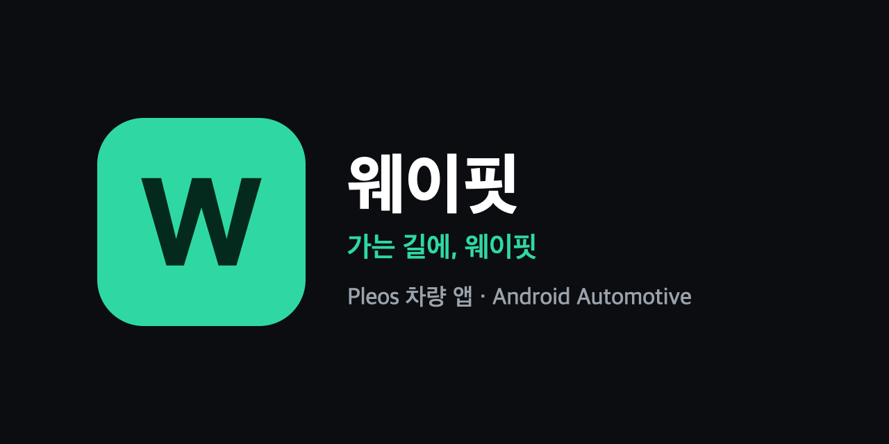
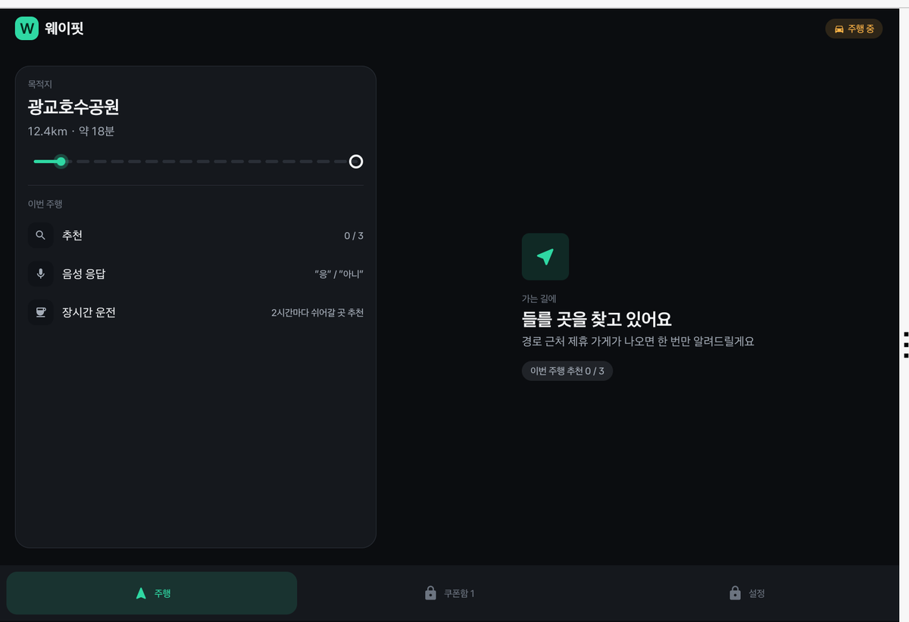
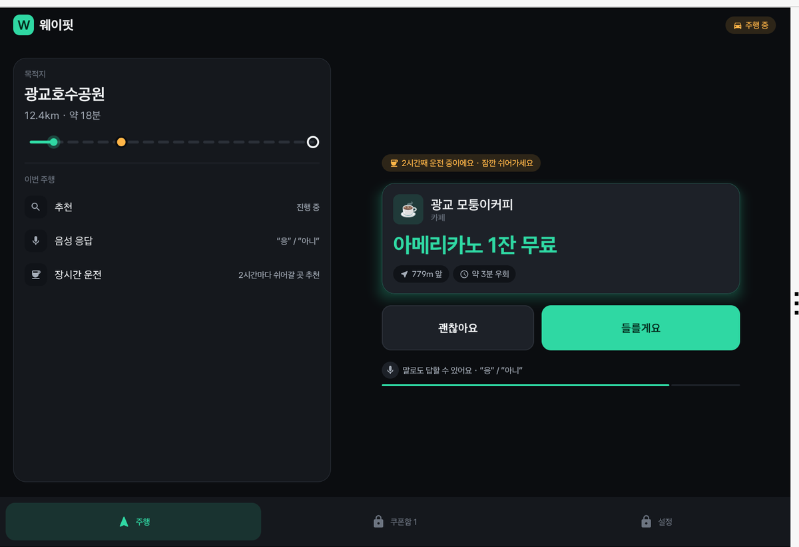
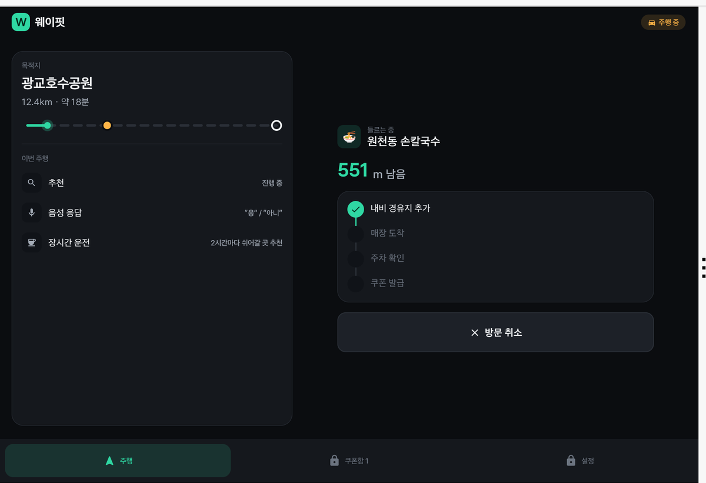
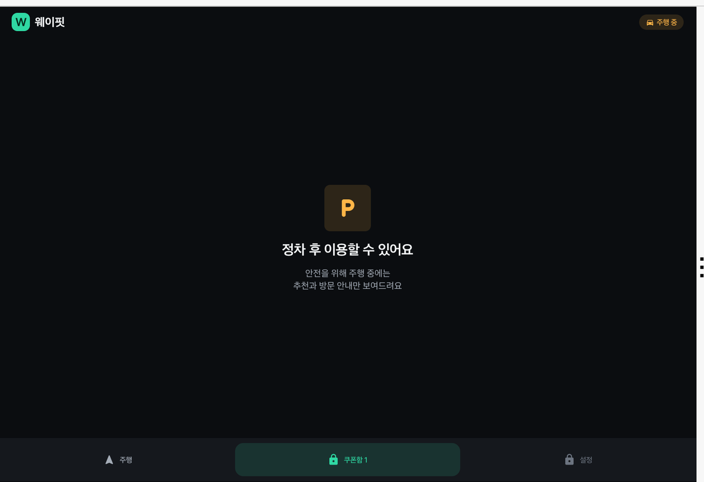
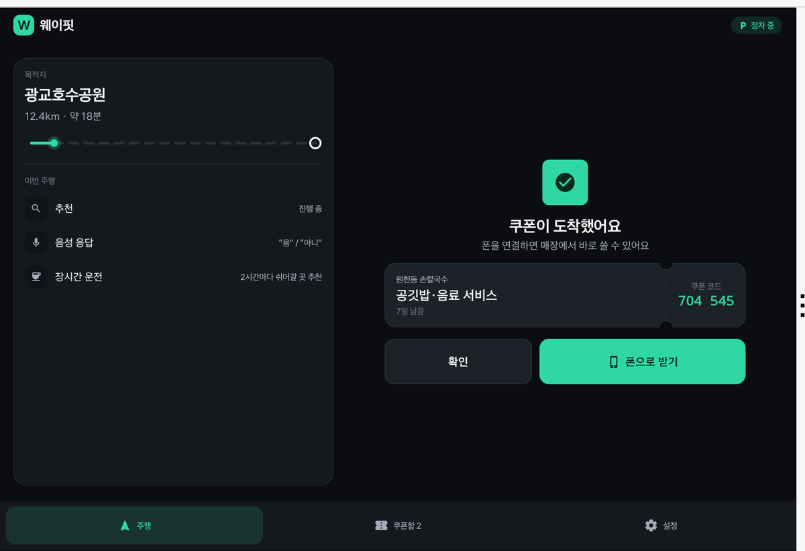
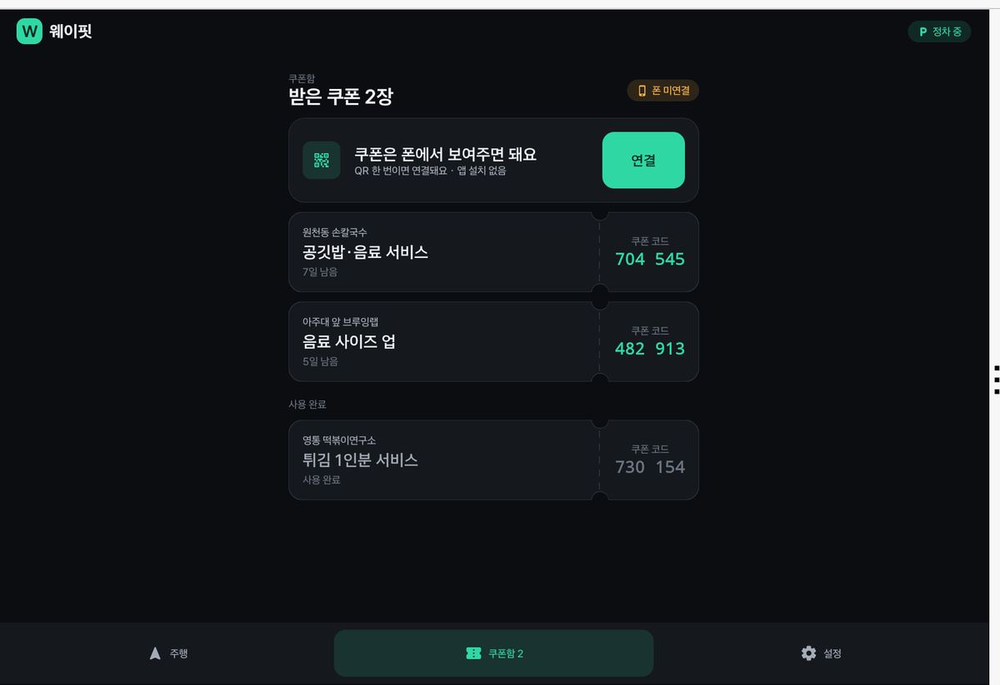
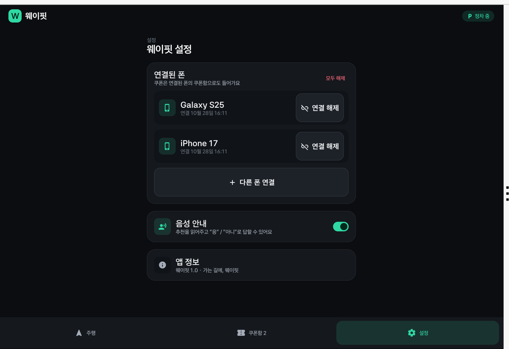
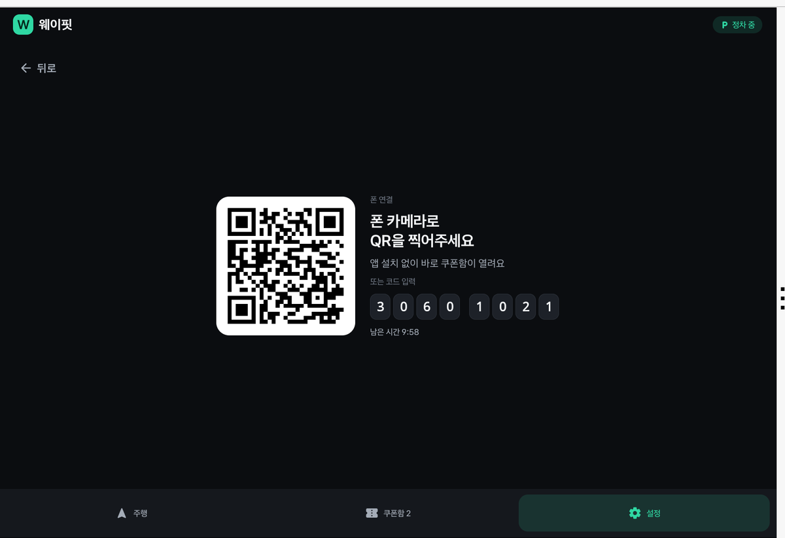

# 웨이핏 (WayFit) — Pleos Connect 차량용 앱



경로 위 동네 가게를 음성으로 추천하고, 들르면 차량 데이터로 방문을 인증해 쿠폰을 주는 앱.

## 화면 (Pleos Connect v2.1.0 에뮬레이터)
| 주행 · 대기 | 경로 위 매장 추천 |
|---|---|
|  |  |
| **방문 진행** (경유지 추가 → 도착 → 주차) | **주행 중 잠금** (정차 전용 화면) |
|  |  |
| **쿠폰 도착** (차량 데이터로 방문 인증) | **쿠폰함** |
|  |  |
| **설정** (연결된 폰 관리 · 음성 안내) | **폰 연결** (QR · 8자리 코드) |
|  |  |

시나리오: 주행 중 경로 위 제휴 매장을 카드 + 음성("들를까요?")으로 추천 → "응"/"들를게요"로 경유지 추가 → 매장 반경 진입 + 기어 P단으로 방문 인증 → 쿠폰 발급 → QR로 연결한 폰에서 사용.

## 개발 환경
- Android Studio, JDK 17+, minSdk 28 / compileSdk·targetSdk 34, Hilt + KSP
- 에뮬레이터: **Pleos Connect v2.1.0** 시스템 이미지 (API 34, `system-images;android-34;pleos_car_emulator;arm64-v8a`)
  - 일반 Android Automotive 이미지에는 Pleos 서비스가 없어 SDK가 동작하지 않는다 (앱은 DEMO 모드로 실행됨)
  - AVD 설정: Automotive → Pleos Connect v2.1.0, RAM 4GB, Default boot = Cold

## Pleos Playground 키 설정
키는 git에 올리지 않는다. 프로젝트 루트의 `local.properties`(gitignore 대상)에 추가한다.
공통 빌드 설정이 담긴 `gradle.properties`는 git에 있으니 **키를 넣지 않는다.**

```properties
pleos.projectId=<프로젝트 ID>
pleos.clientId=<클라이언트 ID>
pleos.clientSecret=<클라이언트 시크릿>
```

비어 있으면 TTS·STT는 온디바이스로만 동작한다.

## 백엔드 연동
- 서버: `https://wayfit-backend.dannyldj.workers.dev` (API 문서 `/v1/docs`). 코드: `data/remote/`
- 첫 실행 때 `POST /v1/devices`로 기기를 등록하고, 받은 기기 토큰을 앱 전용 저장소에 둔다. 이후 요청에는 `DeviceAuthInterceptor`가 `Authorization: Bearer`를 붙인다. 401을 받으면 한 번 다시 등록한다.
- 로컬 서버(`wrangler dev`)에 붙일 때는 `local.properties`에 `wayfit.apiBaseUrl=http://10.0.2.2:8787/`를 넣는다. debug 빌드만 localhost·10.0.2.2로 http를 쓸 수 있다.
- 데모 매장은 아주대 → 광교호수공원 경로에 있다. 차량 위치가 3km 넘게 떨어져 있으면(에뮬레이터) 매장을 차량 주변으로 옮겨 보여준다. 방문 증거 좌표는 서버 좌표로 바꿔서 보낸다.
- 차량 쪽 폰 연결 해제 API가 없어서, 연결 해제는 폰(PWA)에서 한다.
- API 점검: `python3 scripts/api_e2e.py`로 앱과 같은 순서(기기 등록 → 매장 → 방문 → 인증 → 쿠폰 → 페어링)로 서버를 호출해 본다. 다른 서버는 `WAYFIT_API=http://localhost:8787`로 지정한다. 실제 서버에 테스트 기록이 남으므로 CI에서는 수동 실행(Actions → API E2E)으로만 둔다.

## 사용 SDK
| SDK | 버전 | 용도 |
|---|---|---|
| Vehicle | 2.3.2 | 기어 P단(주차), 문 열림, 주행 시간 |
| NaviHelper | 3.0.5 | 현재 위치, 목적지, 경유지 추가, 경유지 도착 |
| FusedLocation | 1.1.3 | 융합 위치, 매장 반경 지오펜스 |
| TextToSpeech | 3.3.1 | 추천·쿠폰 음성 안내 |
| SpeechToText | 3.3.1 | "응/아니" 음성 수락 |

래퍼: `automotive/src/main/java/com/wayfit/wayfitpleos/data/pleos/`

## 아키텍처
`ItBookStoreCleanArchitecture` 프로젝트 구조를 따른다: Clean Architecture(Data · Model · Screen) + MVVM/MVI + Hilt + Navigation Compose.

```
com.wayfit.wayfitpleos/
├── data/
│   ├── di/            # Hilt 모듈 (Repository 바인딩, ApplicationScope)
│   ├── pleos/         # Pleos SDK 래퍼 = 데이터 소스 (Vehicle·Navi·FusedLocation·Voice)
│   └── repository/    # Repository 인터페이스 + Default 구현 (SDK·데모 데이터 → 모델)
├── model/             # 도메인 모델 (Store, Coupon, Pairing, VoiceIntent …)
├── navigation/        # Route, MainNavHost, BottomNavigationBar
├── screen/
│   ├── base/          # BaseViewModel<State, Event>
│   ├── main/          # MainActivity, MainScreen(상단바·탭·DEMO), MainViewModel(SDK 수명)
│   ├── drive/         # 추천 → 방문 → 인증 상태 머신
│   ├── coupon/ pair/ settings/
│   └── WayfitApp.kt   # @HiltAndroidApp
├── ui/theme/          # 디자인 토큰 (docs/DESIGN_SYSTEM.md)
└── widget/            # 공용 컴포넌트 (버튼, 카드, 쿠폰 티켓, 경로 그림 …)
```

- SDK 이벤트와 DEMO 조작은 같은 Repository를 거쳐 같은 흐름을 만든다 (`DemoRepository`, `VehicleRepository.demoSet…`)
- 화면 디자인 규칙: [docs/DESIGN_SYSTEM.md](docs/DESIGN_SYSTEM.md)
- 테스트: JUnit5 + MockK + coroutines-test (`./gradlew :automotive:testDebugUnitTest`). PR마다 GitHub Actions(`android-ci.yml`)가 단위 테스트와 debug 빌드를 돌린다

## DEMO 모드 (debug 빌드)
화면 하단 DEMO 줄에 SDK 연결 상태(✓/✗)와 시연 버튼이 있다. SDK 이벤트가 없을 때 같은 흐름을 버튼으로 진행할 수 있다.
